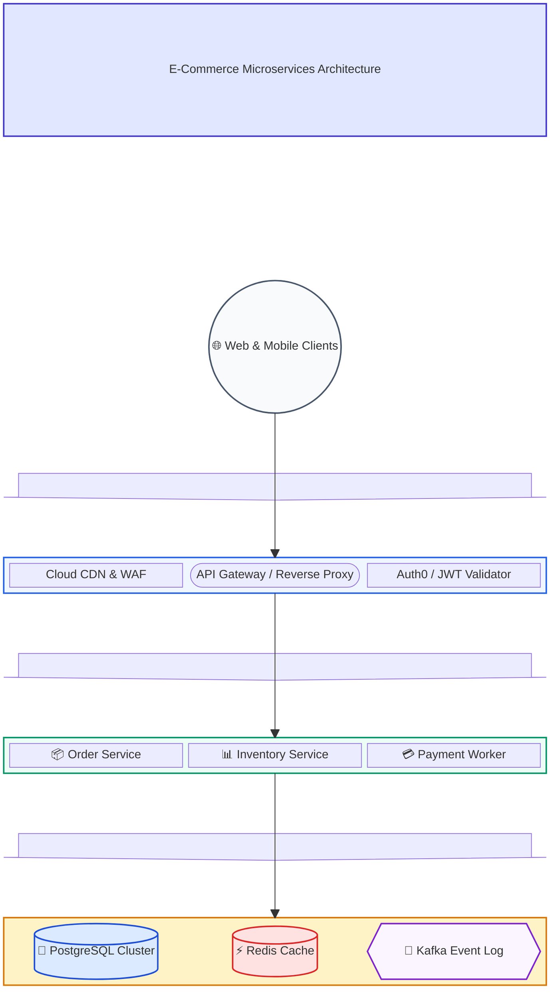
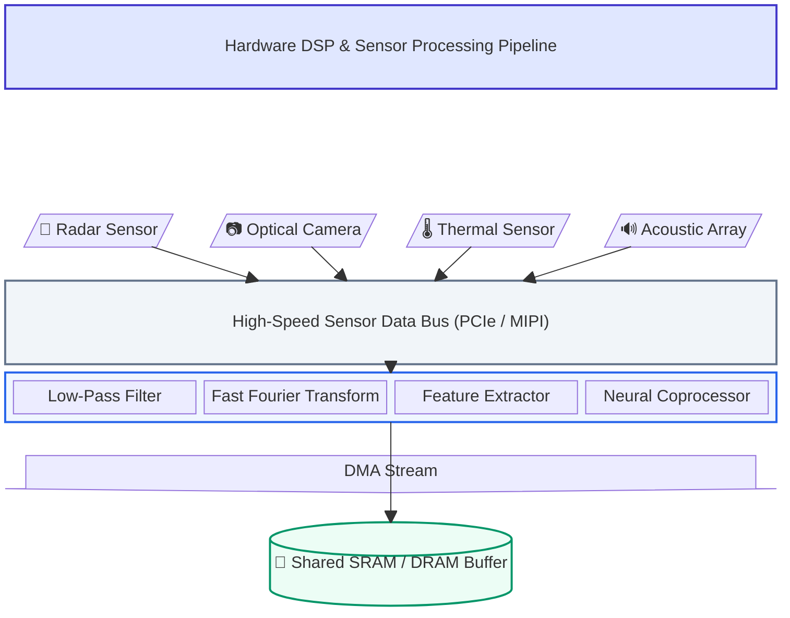

# Block Diagrams Specification & Rules for Mermaid JS

Official Reference: `https://mermaid.ai/open-source/syntax/block.html`

## Overview
The `block-beta` (Block Diagram) syntax in Mermaid JS gives the author full grid-based layout control over component positions, multi-column spanning, nested composite blocks, dimensional block arrows, and inter-block connectors. Unlike standard flowcharts where layout engines move nodes automatically, block diagrams position blocks in a deterministic grid defined by column constraints.

---

## 1. Core Grammar & Syntax Rules

### A. Root Header & Column Grid
1. **Header**: Line 1 MUST be `block-beta`. NEVER append directional keywords like `TD` or `LR`.
2. **Columns Definition**: Line 2 MUST declare the grid columns:
   ```mermaid
   block-beta
     columns 3
   ```
   Valid options: `columns <number>` (e.g. `columns 1`, `columns 3`, `columns 4`, `columns 5`, `columns auto`).

### B. Block Shapes & Notations
Mermaid Block diagrams support rich specialized shapes:
- **Square / Rectangle**: `id["Standard Component"]`
- **Round-Edged Block**: `id("Rounded Process")`
- **Stadium (Pill)**: `id(["Service / API Gateway"])`
- **Subroutine (Double Vertical)**: `id[["Subroutine / Contained Task"]]`
- **Cylindrical Storage**: `id[("Database / Key-Value Store")]`
- **Circle**: `id(("Central Router / User"))`
- **Double Circle**: `id((("High-Priority Core")))`
- **Rhombus (Diamond)**: `id{"Decision / Condition"}`
- **Hexagon**: `id{{"Async Worker / Queue"}}`
- **Parallelogram Lean Right**: `id[/"Input Data Stream"/]`
- **Parallelogram Lean Left**: `id[\"Telemetry Feed"\]`
- **Trapezoid**: `id[/"Batch ETL Processing"\]`
- **Inverted Trapezoid**: `id[\"Aggregator Output"/]`
- **Asymmetric**: `id>"Specialized Process"]`

### C. Column Spanning (`:span`)
Specify how many grid columns an individual block covers:
```mermaid
header["Enterprise Application Architecture"]:3
bus["System Bus"]:4
```

### D. Space Blocks (`space` / `space:N`)
Insert empty grid cells for alignment and clean vertical spacing:
- `space` (takes 1 column width)
- `space:3` (takes 3 column widths)

### E. Dimensional Block Arrows
Wide block arrows provide visual tier transitions:
- **Syntax**: `arrowId<["Label"]>(direction):span` or `arrowId<["&nbsp;&nbsp;"]>(direction):span`
- **Directions**: `(down)`, `(up)`, `(right)`, `(left)`, `(x)`, `(y)`
- **CRITICAL**: The entire arrow definition MUST reside on a SINGLE line!

### F. Nested Composite Blocks (`block:... end`)
Group sub-components into structured subsystem boxes:
```mermaid
block:services:3
  columns 3
  auth["Auth Service"]
  orders["Order Processor"]
  billing["Payment Gateway"]
end
```
**CRITICAL**: Every `block:id` or `block:id:span` group MUST have a matching `end` statement.

### G. Connecting Blocks with Edges
Connect blocks or inner nodes using directional links:
- Standard arrow: `A --> B`
- Bidirectional arrow: `A <--> B`
- Thick arrow: `A ==> B`
- Dotted arrow: `A -.-> B`
- Labeled link: `A -- "Sends RPC" --> B`
- Thick labeled link: `A == "HTTPS / TLS" ==> B`
- Dotted labeled link: `A -. "Telemetry" .-> B`

### H. Semantic Styling & Colors
Apply custom colors at the bottom using `style` or `classDef` statements:
```mermaid
style header fill:#e0e7ff,stroke:#4338ca,stroke-width:2px,color:#312e81
style input fill:#ecfdf5,stroke:#059669,stroke-width:2px,color:#064e3b
style proc fill:#fef3c7,stroke:#d97706,stroke-width:2px,color:#78350f
style store fill:#f3e8ff,stroke:#7e22ce,stroke-width:2px,color:#581c87
style db fill:#eff6ff,stroke:#2563eb,stroke-width:2px,color:#1e40af
```

---

## 2. Canonical Production Examples

### Example 1: Multi-Tier Cloud Software System


### Example 2: Hardware & Embedded Processing Pipeline

