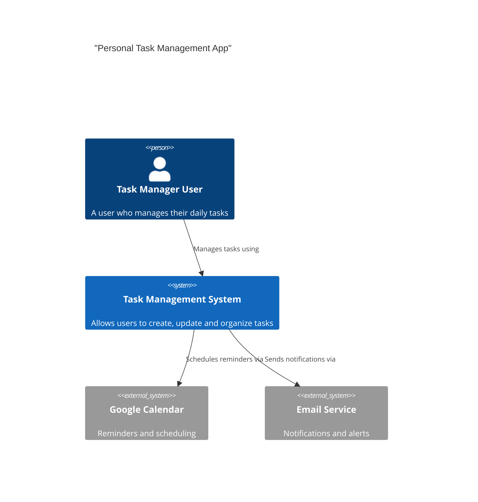
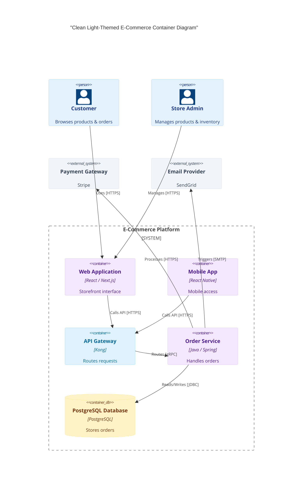

# C4 Diagram Rules & Standards for Mermaid JS

## Syntax Overview
Mermaid C4 diagrams use the C4 model syntax to represent System Context, Containers, or Components.

## Official Structure & Syntax (C4Context)

## Mandatory Directives & Rules

1. **Header Line**:
   - The first line MUST be `C4Context`, `C4Container`, or `C4Component`.
   - **DO NOT** use `flowchart TD` or `flowchart LR`.

2. **Element Macros**:
   - **Person**: `Person(alias, label, ?descr)`
   - **External Person**: `Person_Ext(alias, label, ?descr)`
   - **System**: `System(alias, label, ?descr)`
   - **External System**: `System_Ext(alias, label, ?descr)`
   - **Container**: `Container(alias, label, technology, ?descr)`
   - **Container Database**: `ContainerDb(alias, label, technology, ?descr)`
   - **Component**: `Component(alias, label, technology, ?descr)`

3. **Relationship Macro & Directional Routing**:
   - Relationships MUST use the `Rel` macro or explicit directional variants (`Rel_D`, `Rel_R`, `Rel_L`, `Rel_U`) to prevent overlapping line collisions:
     - `Rel(from, to, label, ?technology)`
     - `Rel_D(from, to, label, ?technology)` (Down)
     - `Rel_R(from, to, label, ?technology)` (Right)
     - `Rel_L(from, to, label, ?technology)` (Left)
     - `Rel_U(from, to, label, ?technology)` (Up)
     - **DO NOT** use standard flowchart arrows like `-->` or `-.->`!

4. **Boundaries (Subsystems)**:
   - To group items and reduce diagonal edge collisions, use boundary blocks:
     ```
     System_Boundary(alias, label) {
         Container(...)
     }
     ```

5. **Custom Element Styling (`UpdateElementStyle`)**:
   - To customize colors to soft/light themes, use `UpdateElementStyle(alias, bgColor, fontColor, borderColor)`:
     - **MUST** pass the explicit node alias (e.g., `web_app`, `user`), NOT generic category names.
     - Example: `UpdateElementStyle(user, "#E3F2FD", "#1E3A8A", "#93C5FD")`

## Anti-Patterns & Common Errors — NEVER DO THESE:

### 1. NEVER Use Flowchart Node Declarations
- **WRONG**:
  ```mermaid
  flowchart TD
      user[User] --> app[App]
  ```
- **CORRECT**:
  ```mermaid
  C4Context
      Person(user, "User")
      System(app, "App")
      Rel_D(user, app, "Uses")
  ```

### 2. NEVER Use Flowchart Arrow Operators
- **WRONG**:
  ```
  user --> app
  ```
- **CORRECT**:
  ```
  Rel_D(user, app, "Uses")
  ```

### 3. NEVER Use Generic Category Strings in `UpdateElementStyle`
- **WRONG** (Ignored by renderer):
  ```
  UpdateElementStyle("person", "#E3F2FD", "#1E3A8A", "#93C5FD")
  ```
- **CORRECT** (Pass node aliases):
  ```
  UpdateElementStyle(user, "#E3F2FD", "#1E3A8A", "#93C5FD")
  ```

### 4. NEVER Use Raw CSS / Class Definitions Inside C4
- **WRONG**:
  ```
  userNode:::blueNode
  ```
- **CORRECT**:
  - Use `UpdateElementStyle(alias, ...)` for node styling in C4.

## Comprehensive Example - Clean Light-Themed E-Commerce Container Diagram

