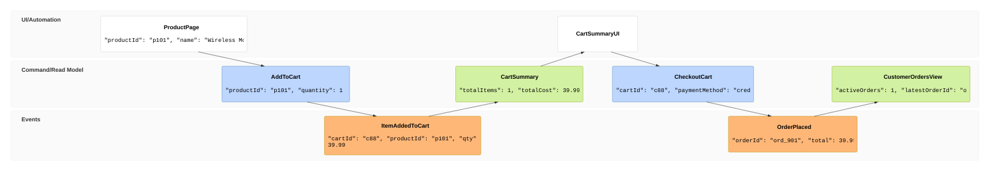
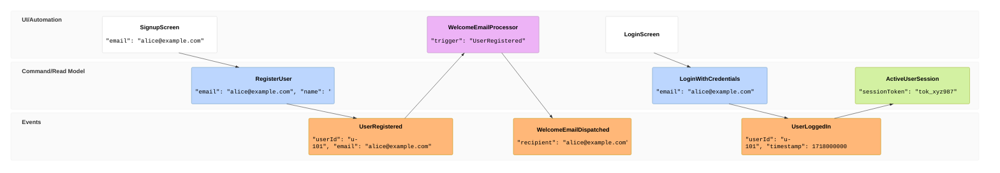

# Event Modeling Rules & Standards for Mermaid JS (eventmodeling)

## Overview
Event Modeling is a method of describing information systems using a timeline of how information changes over time. It visually maps how user intent (UI/Commands) transforms into persistent state changes (Events) and queryable projections (Read Models) without transient implementation details.

In Mermaid (v11.15.0+), Event Modeling is natively supported via the `eventmodeling` diagram type.

---

## 1. Core Architecture & Swimlanes

Mermaid automatically organizes entities into three standard horizontal swimlanes based on their Entity Type:

| Swimlane | Entity Types | Tokens (Compact / Relaxed) | Purpose |
| :--- | :--- | :--- | :--- |
| **UI / Automation** (Top) | User Interface | `ui` | Screens, web/mobile views, forms |
| | Processor / Automation | `pcr` / `processor` | Background workers, schedulers, notification services |
| **Command / Read Model** (Middle) | Command | `cmd` / `command` | Intent to change system state (imperative verb) |
| | Read Model / View | `rmo` / `readmodel` | Queryable projections built from past events |
| **Events** (Bottom) | Domain Event | `evt` / `event` | Immutable facts that happened in the past (past tense) |

---

## 2. Syntax & Time Frame Grammar

### A. Declaration
Line 1 MUST be `eventmodeling`:
```mermaid
eventmodeling
```

### B. Time Frames (`tf` / `timeframe`)
A timeline is composed of Time Frame definitions. Each Time Frame has:
1. Keyword: `tf` (or `timeframe`)
2. Unique two-digit index (e.g. `01`, `02`, `03`...)
3. Entity type (`ui`, `pcr`, `cmd`, `rmo`, `evt`)
4. Entity Identifier (PascalCase or single-word identifier, e.g. `CartUI`, `AddItem`, `ItemAdded`, `CartSummary`)
5. Optional inline JSON payload: `` `json`{ ... } `` or `{ ... }`

```
tf 01 ui CartUI
tf 02 cmd AddItem
tf 03 evt ItemAdded
tf 04 rmo CartSummary
```

### C. Reset Frames (`rf` / `resetframe`)
To start a new slice, break automatic inference, or model a parallel user interaction, use a Reset Frame:
```
rf 05 ui CheckoutUI
tf 06 cmd SubmitOrder
tf 07 evt OrderPlaced
```

### D. Multiple Relations (`->>`)
When a read model or processor aggregates data from multiple previous events, reference them with `->>`:
```
tf 08 rmo UserOrderDashboard ->> 03, 07
```

### E. Data Blocks & Inline Data
Provide real-world data examples to demonstrate state mutation:
```
tf 01 ui CartUI `json`{ "userId": "usr_42" }
tf 02 cmd AddItem `json`{ "sku": "SHIRT-BLU-M", "quantity": 2 }
tf 03 evt ItemAdded `json`{ "sku": "SHIRT-BLU-M", "quantity": 2, "price": 24.99 }
tf 04 rmo CartSummary `json`{ "itemCount": 2, "subtotal": 49.98 }
```

---

## 3. Canonical Examples

### Example 1: E-Commerce Shopping & Checkout Lifecycle


### Example 2: User Onboarding with Background Processor


---

## 4. Best Practices
1. **PAST TENSE FOR EVENTS**: Name events as completed facts (`OrderPlaced`, `ItemAdded`, `PaymentCaptured`, `InvoiceGenerated`).
2. **IMPERATIVE VERBS FOR COMMANDS**: Name commands as direct actions (`PlaceOrder`, `AddItem`, `AuthorizePayment`, `GenerateInvoice`).
3. **SEQUENTIAL INDEXING**: Use ascending two-digit numbers (`01`, `02`, `03`...) for clarity and chronological readability.
4. **CQRS PATTERN**: Follow the standard information flow: `UI -> Command -> Event -> Read Model -> UI`.

---

## 5. CRITICAL Anti-Patterns — NEVER DO THESE
1. **NEVER use `flowchart LR` or `flowchart TB` or subgraphs for Event Modeling diagrams**. Always use native `eventmodeling`.
2. **NEVER use custom flowchart shapes or node IDs** like `UI1["..."]` or `subgraph userSwimlane ... end`.
3. **ONLY use valid timeframe types**: `ui`, `pcr` (or `processor`), `cmd` (or `command`), `rmo` (or `readmodel`), `evt` (or `event`).
