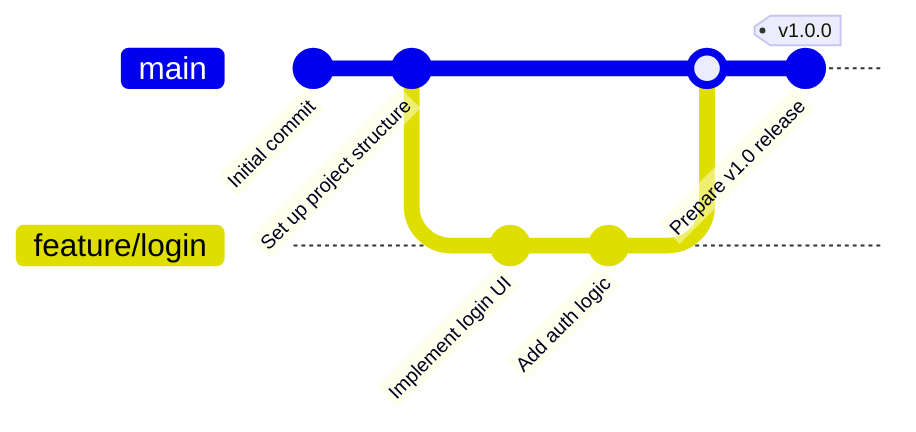
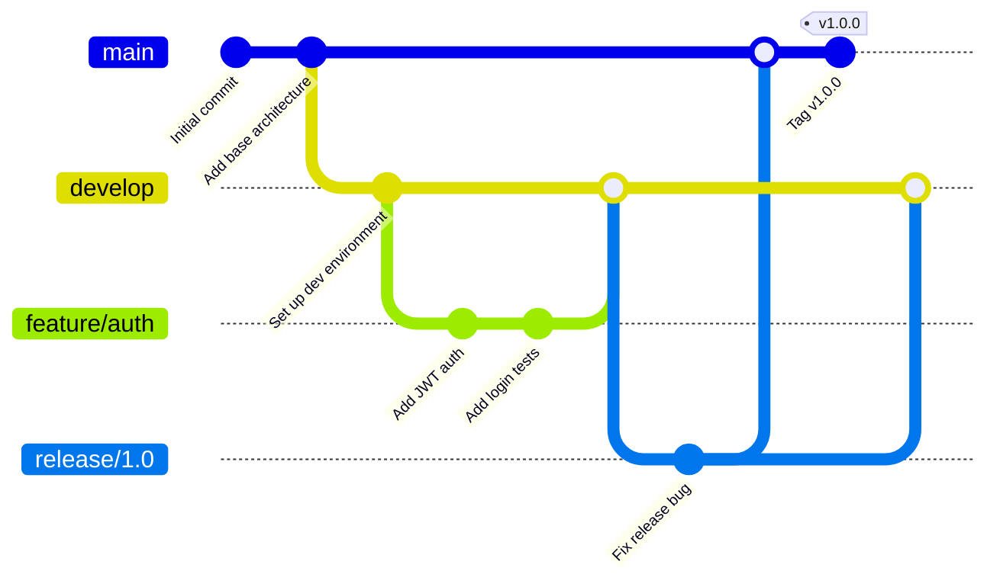

# GitGraph Rules & Standards for Mermaid JS

## Syntax Overview
Mermaid `gitGraph` visualizes Git branching, commits, merges, and tags.

## Official Structure & Syntax


## Mandatory Directives & Rules

1. **Header Line**:
   - The first line MUST be `gitGraph` (or `gitGraph:`).

2. **Default `main` Branch**:
   - The diagram automatically starts on `main`.
   - **DO NOT** execute `branch main` at the start, as `main` already exists!
   - Use `checkout main` to switch back to the main branch.

3. **Branch Creation before Checkout**:
   - Always create a branch with `branch <branch-name>` BEFORE checking it out with `checkout <branch-name>`.
   - **DO NOT** call `checkout` on a branch name that has not been created with `branch`.

4. **Globally Unique Commit IDs (CRITICAL)**:
   - Every `commit id: "..."` MUST be unique across the ENTIRE diagram.
   - **WRONG**: Using `commit id: "Add 1"` on `feature/a` AND `commit id: "Add 1"` on `feature/b`.
   - **CORRECT**: Use distinct IDs such as `commit id: "Add login UI"` and `commit id: "Add payment UI"`.

5. **Merge Rules**:
   - `merge <branch-name>` merges `<branch-name>` into the CURRENTLY checked out branch.
   - **DO NOT** merge a branch into itself (e.g. `checkout feature/payment` followed by `merge feature/payment`).
   - To merge a feature branch into `main`:
     ```
     checkout main
     merge feature/login
     ```
   - To merge `main` into a feature branch:
     ```
     checkout feature/payment
     merge main
     ```

6. **Tags**:
   - Tags can be attached directly to commits: `commit id: "Version bump" tag: "v2.0.0"` or `tag: "v1.0.0"` following a commit.

7. **Unsupported Git Operations**:
   - Mermaid `gitGraph` DOES NOT support `rebase` or `delete branch` directives.
   - If a prompt asks for rebasing or deleting branches, represent the final branch history with `commit` and `merge` statements cleanly.

## Anti-Patterns & Common Errors — NEVER DO THESE:

### 1. NEVER Declare `branch main`
- **WRONG**:
  ```mermaid
  gitGraph
      commit id: "Start"
      branch main
  ```
- **CORRECT**:
  ```mermaid
  gitGraph
      commit id: "Start"
      checkout main
  ```

### 2. NEVER Reuse Commit IDs
- **WRONG**:
  ```
  checkout feature/payment
  commit id: "Add 1"
  checkout feature/profile
  commit id: "Add 1"
  ```
- **CORRECT**:
  ```
  checkout feature/payment
  commit id: "Payment step 1"
  checkout feature/profile
  commit id: "Profile step 1"
  ```

### 3. NEVER Checkout Uncreated Branches
- **WRONG**:
  ```
  checkout feature/profile
  commit id: "First commit"
  ```
- **CORRECT**:
  ```
  branch feature/profile
  checkout feature/profile
  commit id: "First commit"
  ```

### 4. NEVER Merge Branch into Self
- **WRONG**:
  ```
  checkout feature/payment
  merge feature/payment
  ```
- **CORRECT**:
  ```
  checkout main
  merge feature/payment
  ```

## Comprehensive Example - Multi-Branch Workflow

