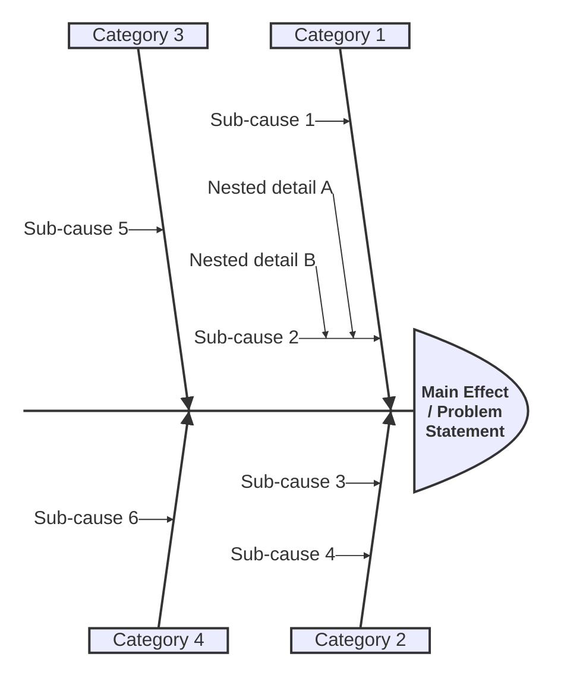
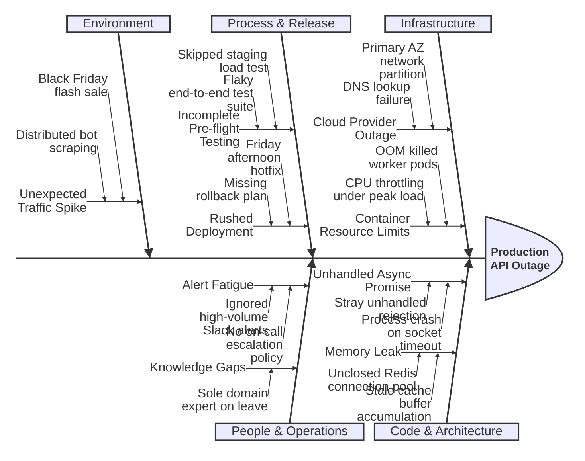
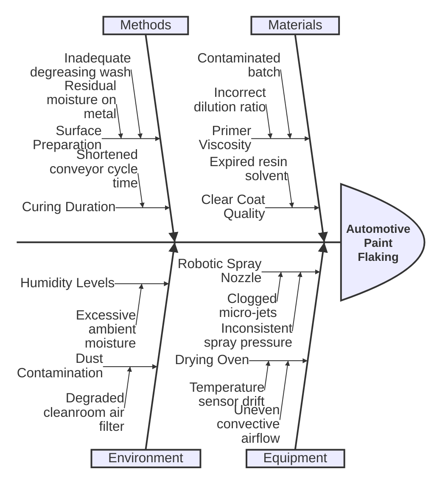

# Ishikawa (Fishbone) Diagram Rules & Standards for Mermaid JS

## Overview
Mermaid JS natively supports official Ishikawa (Fishbone / Cause-and-Effect) diagrams using the `ishikawa-beta` diagram type. It automatically renders a horizontal central spine pointing to the problem statement (the fish head) on the right, with diagonal rib bones extending outward for major cause categories (e.g. Equipment, Process, People, Environment, Measurements, Materials) and multi-level branches for specific root causes.

## Syntax & Core Structure

---

## Mandatory Directives & Rules

1. **Header Line**:
   - Line 1 MUST be exactly `ishikawa-beta`.
   - **NEVER** use `flowchart RL`, `flowchart LR`, or `graph`.

2. **Main Problem / Effect Statement (Fish Head)**:
   - Line 2 MUST be the problem or effect statement (e.g. `Server Downtime`, `Blurry Photo`, `High Employee Turnover`), indented with 2 spaces.
   - **DO NOT** add brackets (`[...]`), shapes, or arrows (`-->`). Just the raw plain text.

3. **Primary Cause Categories**:
   - Define 4 to 6 categories (such as the standard 6Ms: `Methods`, `Machines`, `Materials`, `Measurements`, `Manpower / People`, `Environment`), indented by 2 spaces.

4. **Causes & Sub-causes**:
   - List causes under their respective category, indented by 4 spaces.
   - For sub-causes (nested branches), indent them by 6 spaces (or 2 additional spaces).

5. **No Nodes or Flowchart Syntax**:
   - **NEVER** use node IDs like `P1["..."]`, `-->`, `subgraph`, `end`, or `classDef`.
   - The layout is purely defined by indentation hierarchy under `ishikawa-beta`.

---

## Realistic Examples

### Example 1: Software System Incident Root Cause Analysis

### Example 2: Manufacturing & Quality Assurance

