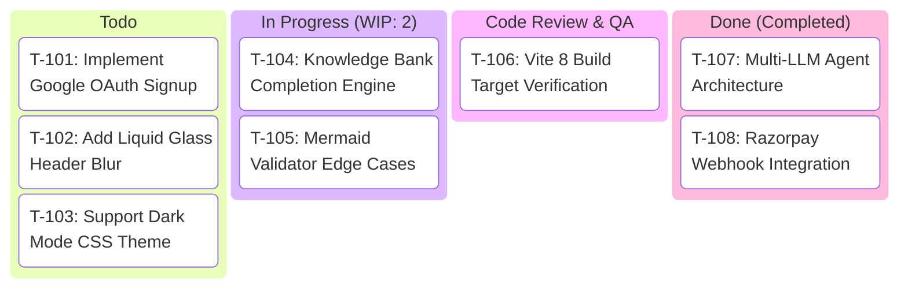

# Kanban Board Rules & Standards for Mermaid JS

## Overview
Kanban diagrams visualize agile project workflows, task stages, sprint backlogs, WIP (Work In Progress) limits, and item statuses from To-Do to Done.

## Syntax & Standard Implementations
Mermaid supports both native `kanban` and columnar `flowchart LR` representations:

### Pattern A: Native `kanban` Syntax (Mermaid 11+)

### Pattern B: Columnar Flowchart Kanban (Rich Visual Cards & Badges)

```mermaid
flowchart LR
    subgraph Backlog ["📋 Backlog"]
        B1["🏷️ FE-101: Dark Mode Toggle\n👤 Dhruv · ⚡ 3 pts"]:::cardLow
        B2["🏷️ BE-204: API Rate Limiter\n👤 Backend · ⚡ 5 pts"]:::cardMed
    end

    subgraph InProgress ["⚡ In Progress (WIP: 2)"]
        IP1["🔥 FE-102: Liquid Glass Header Fix\n👤 Frontend · ⚡ 2 pts"]:::cardHigh
        IP2["🚀 AI-301: Diagram Knowledge Engine\n👤 Agent · ⚡ 8 pts"]:::cardHigh
    end

    subgraph Review ["🔍 Code Review & QA"]
        R1["🧪 QA-401: OAuth Localhost Verification\n👤 QA · ⚡ 3 pts"]:::cardMed
    end

    subgraph Done ["✅ Done"]
        D1["📦 SYS-500: Firebase Auth Setup\n👤 System · ⚡ 5 pts"]:::cardDone
    end

    Backlog --> InProgress --> Review --> Done

    style Backlog fill:#f8fafc,stroke:#94a3b8,stroke-width:2px,color:#0f172a;
    style InProgress fill:#eff6ff,stroke:#3b82f6,stroke-width:2px,color:#1e3a8a;
    style Review fill:#fefce8,stroke:#eab308,stroke-width:2px,color:#713f12;
    style Done fill:#f0fdf4,stroke:#22c55e,stroke-width:2px,color:#14532d;

    classDef cardLow fill:#ffffff,stroke:#cbd5e1,stroke-width:1.5px,color:#1e293b;
    classDef cardMed fill:#ffffff,stroke:#f59e0b,stroke-width:1.5px,color:#1e293b;
    classDef cardHigh fill:#ffffff,stroke:#ef4444,stroke-width:1.5px,color:#1e293b;
    classDef cardDone fill:#ffffff,stroke:#10b981,stroke-width:1.5px,color:#1e293b;
```

## Best Practices
1. **WIP LIMITS**: Note Work-In-Progress limits on active columns (e.g. `In Progress (WIP: 3)`).
2. **RICH TICKET METADATA**: Include ticket IDs (e.g. `FE-102`), summary, assignee, and priority in card descriptions.
3. **LEFT-TO-RIGHT STAGE FLOW**: Standard columns follow Backlog -> To Do -> In Progress -> Code Review/QA -> Done.
4. **UNQUOTED NODE IDENTIFIERS**: When using flowchart subgraphs, node IDs MUST be bare alphanumeric identifiers (e.g. `Task1["..."]`). NEVER quote the identifier like `"Task 1"["..."]`, as Mermaid rejects quoted node IDs inside subgraphs.
