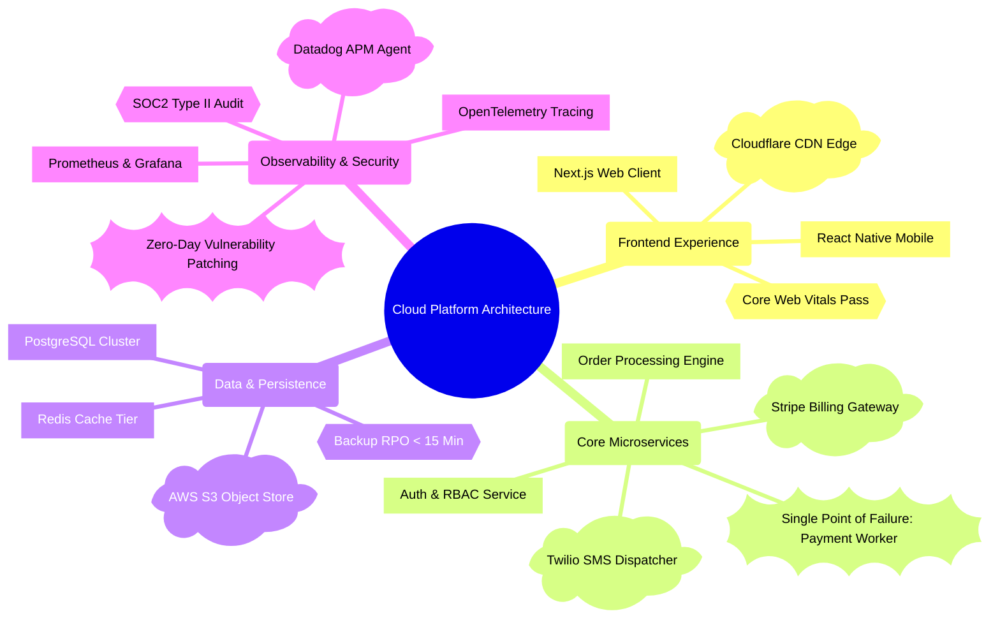
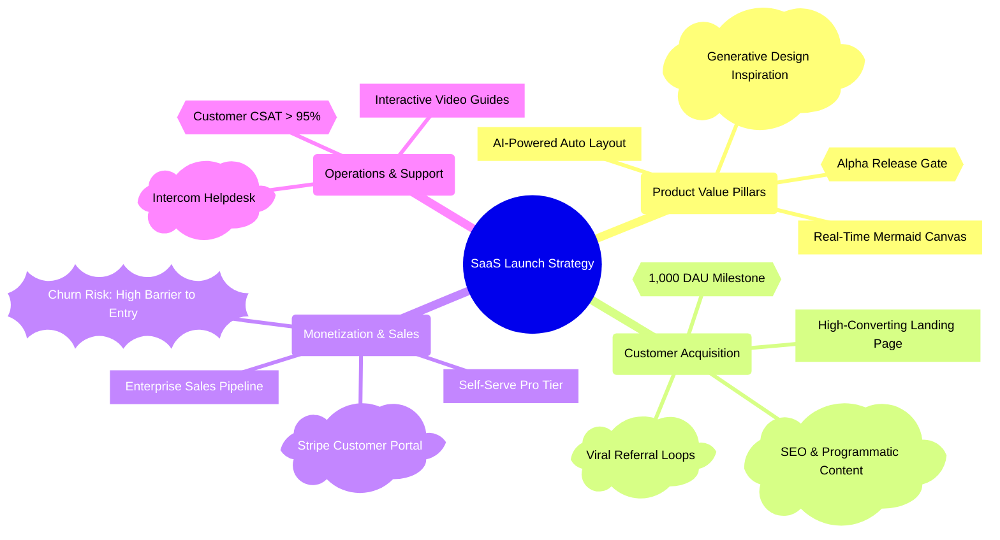

# Mindmap Rules & Standards for Mermaid JS

## Executive Overview
Mermaid `mindmap` visualizes hierarchies, mental models, systems, architectures, workflows, and brainstorms using strict indentation and semantic node shapes.

A professional, human-readable mindmap in ARKA is **NOT** a monochrome wall of identical rectangles. Instead, it uses intentional geometric shapes to visually telegraph the nature of each node at a glance.

---

## The 7 Official Mindmap Node Shapes & Semantic Decision Rules

Mermaid JS natively supports 7 distinct geometric shapes for mindmap nodes. Always use these shapes according to their semantic purpose:

| Shape Name | Syntax (Delimiters) | Visual Style | When to Use (Semantic Rules) | Concrete Examples |
| :--- | :---: | :---: | :--- | :--- |
| **Circle** | `((Text))` | Circular Bubble | **Central Root & Anchor Concepts:** Exactly one root per mindmap representing the overarching subject, question, or system. | `root((2026 Cloud Architecture))` |
| **Rounded Rectangle** | `(Text)` | Soft Rounded Card | **Level-1 Pillars & Major Categories:** Primary domains, departments, or strategic pillars radiating directly from the root. | `(Security & Auth)`, `(Data Ingestion)`, `(User Experience)` |
| **Square / Rectangle** | `[Text]` | Crisp Sharp Box | **Concrete Deliverables, Tasks & Modules:** Tangible components, code modules, databases, sprint tasks, direct outputs, and technical tools. | `[PostgreSQL Cluster]`, `[REST API Gateway]`, `[Unit Test Suite]` |
| **Cloud** | `)Text(` | Organic Cloud Contour | **External Cloud Services, Third-Party APIs, Brainstorm Ideas & Hypotheses:** <br>1. External SaaS / cloud infrastructure (AWS, Stripe, Twilio, OpenAI, CDN).<br>2. Creative brainstorms, exploratory ideas, open hypotheses, loose inspirations. | `)OpenAI GPT-4o API(`, `)AWS S3 Storage(`, `)Brainstorm: Viral Loop?(` |
| **Bang (Explosion)** | `))Text((` | Spiky Burst Shape | **Urgent Risks, Critical Blockers, Alarms & Breakthrough Highlights:** <br>1. Critical security risks, P0 bugs, compliance traps, single points of failure.<br>2. Game-changing discoveries, launch announcements, breakthrough insights.<br>*Rule:* Use sparingly (1 to 2 max per mindmap) for true visual punch. | `))"🚨 P0: Security Vulnerability"((`, `))Single Point of Failure((`, `))10x Conversion Win!((` |
| **Hexagon** | `{{Text}}` | Angled 6-Sided Hexagon | **Decision Gates, Milestones & Verification Checkpoints:** Go/no-go gates, quality thresholds, audit approvals, compliance sign-offs, phase milestones, and test checkpoints. | `{{SOC2 Type II Audit Passed}}`, `{{10k Active Users Milestone}}`, `{{Go/No-Go Decision Gate}}` |
| **Plain / Default** | `"Text"` (or no brackets) | Borderless Clean Text | **Granular Notes & Leaf Specifications:** Level 3+ leaf nodes, fine-grained details, metrics, or footnotes where shape borders would clutter the diagram. | `"Target latency < 50ms"`, `"Weekly Monday cadence"` |

> [!CAUTION]
> **CRITICAL SYNTAX WARNING: Delimiters for Cloud & Bang are Inverted!**
> - **Cloud** opens with a closing parenthesis `)` and closes with an opening parenthesis `(`: `)Cloud Label(`
>   - *Wrong:* `(Cloud Label)` ❌ (This creates a Rounded node!)
> - **Bang** opens with two closing parentheses `))` and closes with two opening parentheses `((`: `))Bang Label((`
>   - *Wrong:* `((Bang Label))` ❌ (This creates a Circle node!)
> Reversing these delimiters will result in either the wrong shape or a fatal Mermaid parser syntax error!

---

## Semantic Shape Decision Tree (When to Pick Which Shape)

When generating or refining a mindmap, evaluate each node against this decision framework:

1. **Is this the central subject of the entire diagram?**
   → Use **Circle**: `root((Subject))`
2. **Is this a primary category/pillar (direct child of root)?**
   → Use **Rounded Rectangle**: `(Category Name)`
3. **Is this an external SaaS, cloud API, third-party vendor, or exploratory brainstorm/hypothesis?**
   → Use **Cloud**: `)External Service / Idea(`
4. **Is this an urgent risk, launch blocker, P0 alert, or game-changing breakthrough?**
   → Use **Bang**: `))Critical Risk / Highlight((` *(Reserve for 1-2 key items)*
5. **Is this a milestone, decision gate, sign-off, or audit threshold?**
   → Use **Hexagon**: `{{Approval Gate / Milestone}}`
6. **Is this a concrete software component, sprint task, tool, or engineering deliverable?**
   → Use **Rectangle**: `[Component / Task]`
7. **Is this a fine-grained sub-note, metric, or leaf footnote?**
   → Use **Plain / Default**: `"Clean detail"`

---

## Design Rules for Clean, Readable, and Well-Balanced Mindmaps

To ensure diagrams generated in ARKA look world-class, adhere strictly to these design rules:

### 1. The Anti-Monoculture Rule (Mandatory Shape Diversity)
- **NEVER** generate a mindmap where every node uses the same shape (e.g. all `[...]` rectangles or all plain text).
- A well-designed mindmap must utilize a balanced mix of shapes across branches to create an informative visual hierarchy.

### 2. Radial Balance & Branch Distribution
- **Optimal Breadth**: 3 to 6 primary branches radiating out from the root.
  - Less than 3 looks sparse and linear.
  - More than 7 causes radial overcrowding and visual noise.
- **Optimal Depth**: 2 to 4 levels of indentation.
  - Level 0: Root `((...))`
  - Level 1: Major Domains `(...)`
  - Level 2: Specific Functional Areas / Deliverables `[...]`, External Integrations `)...(`, Milestones `{{...}}`
  - Level 3: Tactical Tasks, Alert Callouts `))...((`, or Granular Details

### 3. Label Conciseness & Readability
- Keep node labels short, punchy, and scannable (2 to 5 words).
- Avoid multi-sentence paragraphs inside node labels.

### 4. Mandatory Label Quoting
- When a node label contains commas `,`, colons `:`, parentheses `()`, ampersands `&`, slashes `/`, hyphens, or emojis, wrap the label text in double quotes **inside** the shape delimiter:
  - Correct: `["Auth, OAuth & SAML 2.0"]`
  - Correct: `)"Third-Party: Stripe Payments"(`
  - Correct: `))"🚨 P0: Data Leak Risk"((`
  - Correct: `(("Master Roadmap: 2026-2027"))`
  - Correct: `{{"Milestone: 99.99% SLA"}}`

### 5. Strict Indentation Hygiene
- Hierarchy is established **exclusively** through whitespace indentation (2 spaces or 4 spaces per nesting level).
- All sibling nodes under the same parent **must** have the exact same indentation column.
- Never mix tabs and spaces.

### 6. Never Use Flowchart Arrows or Custom Styles
- **NEVER** use flowchart connectors like `-->`, `==>`, `-.->`, or `-- text -->`.
- **NEVER** write `classDef` or `style` lines. Mermaid mindmaps do not support custom style directives; ARKA handles dynamic theme coloring automatically.

---

## Comprehensive Production Examples

### Example 1: System Architecture & Cloud Infrastructure Mindmap


### Example 2: Product Strategy & Go-To-Market Mindmap


### Example 3: Clinical Healthcare Management Mindmap
```mermaid
mindmap
  root((Hospital Patient Journey))
    (Emergency Intake)
      [Triage Nurse Assessment]
      [Vitals Telemetry Logging]
      ))Immediate Trauma Alert((
      {{Bed Availability Check}}
    (Diagnostic Services)
      [CT Scan & Digital X-Ray]
      [Blood & Pathology Panel]
      )External Pathology Lab API(
      {{Critical Lab Results Gate}}
    (Clinical Treatment)
      [Physician Diagnosis]
      [Medication Administration]
      )Electronic Health Record (EHR)(
      [Discharge Care Plan]
    (Post-Discharge Follow-Up)
      [Telehealth Consultation]
      )Automated Patient SMS Survey(
      {{30-Day Readmission Target}}
```
