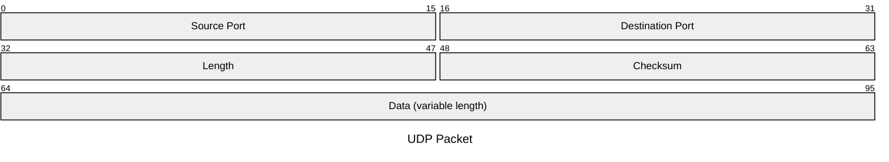
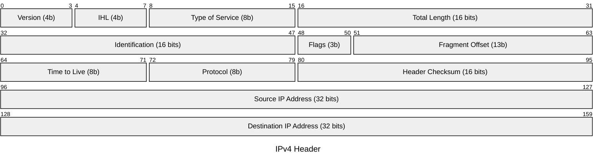
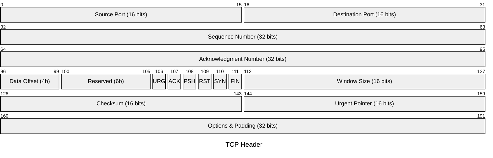

# Packet Diagram Rules & Standards for Mermaid JS

## Overview
Packet diagrams visualize network protocols, binary header layouts, packet framing, memory-mapped I/O fields, byte offsets, and bit boundaries (e.g. TCP/IP headers, IPv6 frames, UDP packets, DNS packets, WebSocket frames, Ethernet frames).

---

## Core Directives & Syntax (`packet-beta`) [DEFAULT]

1. **Header Line**: Line 1 MUST be exactly `packet-beta`.
2. **Optional Title**: Line 2 can define `title <Title Name>` (e.g. `title UDP Packet Header`).
3. **Bit Range Fields**:
   - Multi-bit range format: `<startBit>-<endBit>: "<Field Name>"` (e.g. `0-15: "Source Port (16 bits)"`)
   - Single-bit format: `<bit>: "<Flag Name>"` (e.g. `106: "URG"`)
4. **Contiguous & Non-Overlapping**:
   - Bit indices MUST start at `0` and increase sequentially without gaps or overlaps.
   - Example: `0-15` followed by `16-31`, `32-47`, `48-63`, `64-95`.
   - If a bit sequence is reserved or unused, declare it explicitly (e.g. `96-105: "Reserved (10b)"`).
5. **Double Quotes**: Enclose all field labels in double quotes.

---

## Standard Examples

### Example 1: UDP Packet Header

### Example 2: IPv4 Header Layout

### Example 3: TCP Segment Header

---

## Best Practices
1. **Accurate Bit Boundaries**: Ensure fields align to 32-bit (or 64-bit) word rows whenever modeling standard protocols.
2. **Clear Field Labels**: Include both the field description and bit width in quotes.
3. **Continuous Indexing**: Never jump from bit 15 to bit 20 without declaring the bits in between.
