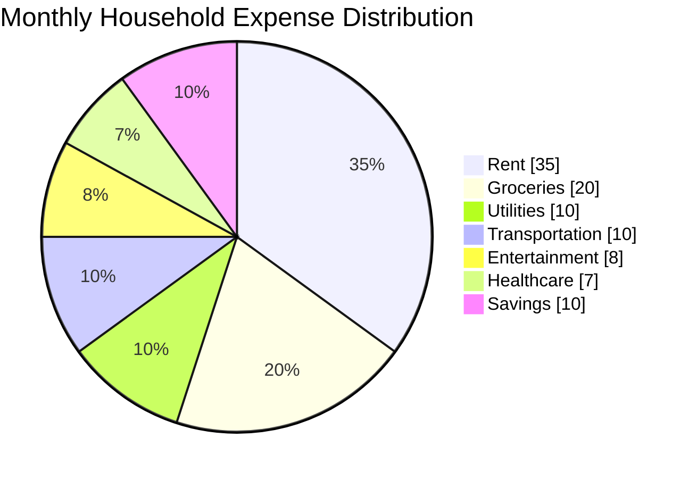
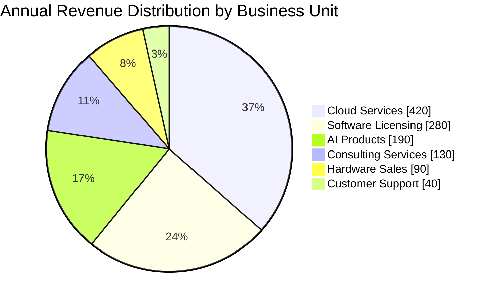

# Pie Chart Rules & Standards for Mermaid JS

## Syntax Overview
Mermaid `pie` charts visualize proportions and percentages across categories.

## Official Structure & Syntax


## Mandatory Directives & Rules

1. **Header Line**:
   - Must start with `pie` (or `pie showData` to display numeric/percentage values on the slices).

2. **Title**:
   - `title "Chart Title"` or `title Chart Title`

3. **Slice Definitions**:
   - Format: `"Slice Label" : numeric_value`
   - Every slice label MUST be wrapped in double quotes `"..."`.
   - Values MUST be clean numeric numbers (integers or decimals, e.g. `35`, `1450`, `6.5`).
   - **DO NOT** include currency symbols (`$`), commas (`1,450`), or percent signs (`%`) in the slice values!
     - **WRONG**: `"Rent" : $1200`, `"Sales" : 1,450`, `"Share" : 24%`
     - **CORRECT**: `"Rent" : 1200`, `"Sales" : 1450`, `"Share" : 24`

4. **Unsupported Features (CRITICAL)**:
   - Mermaid `pie` syntax **DOES NOT SUPPORT** `explode`, `slice offset`, `pull out`, or sub-slicing directives.
   - **NEVER** write `explode`, `offset`, or attempt slice displacement directives. Mermaid does not support slice exploding.

## Anti-Patterns & Common Errors — NEVER DO THESE:

### 1. NEVER Use Explode / Offset Directives
- **WRONG**:
  ```
  pie showData
      title Market Share
      explode "Samsung"
      "Samsung" : 24
  ```
- **CORRECT**:
  ```mermaid
  pie showData
      title Market Share Distribution
      "Samsung" : 24
      "Apple" : 21
  ```

### 2. NEVER Put Currency Symbols, Commas, or Percent Signs in Values
- **WRONG**:
  ```
  "Cloud Services" : $420M
  "Students" : 1,450
  "Share" : 25%
  ```
- **CORRECT**:
  ```
  "Cloud Services" : 420
  "Students" : 1450
  "Share" : 25
  ```

### 3. NEVER Leave Slice Labels Unquoted
- **WRONG**:
  ```
  Software Development : 380
  ```
- **CORRECT**:
  ```
  "Software Development" : 380
  ```

## Comprehensive Example

