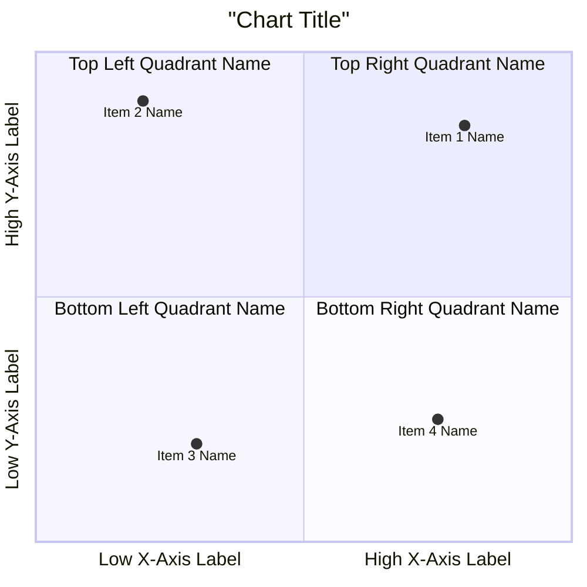
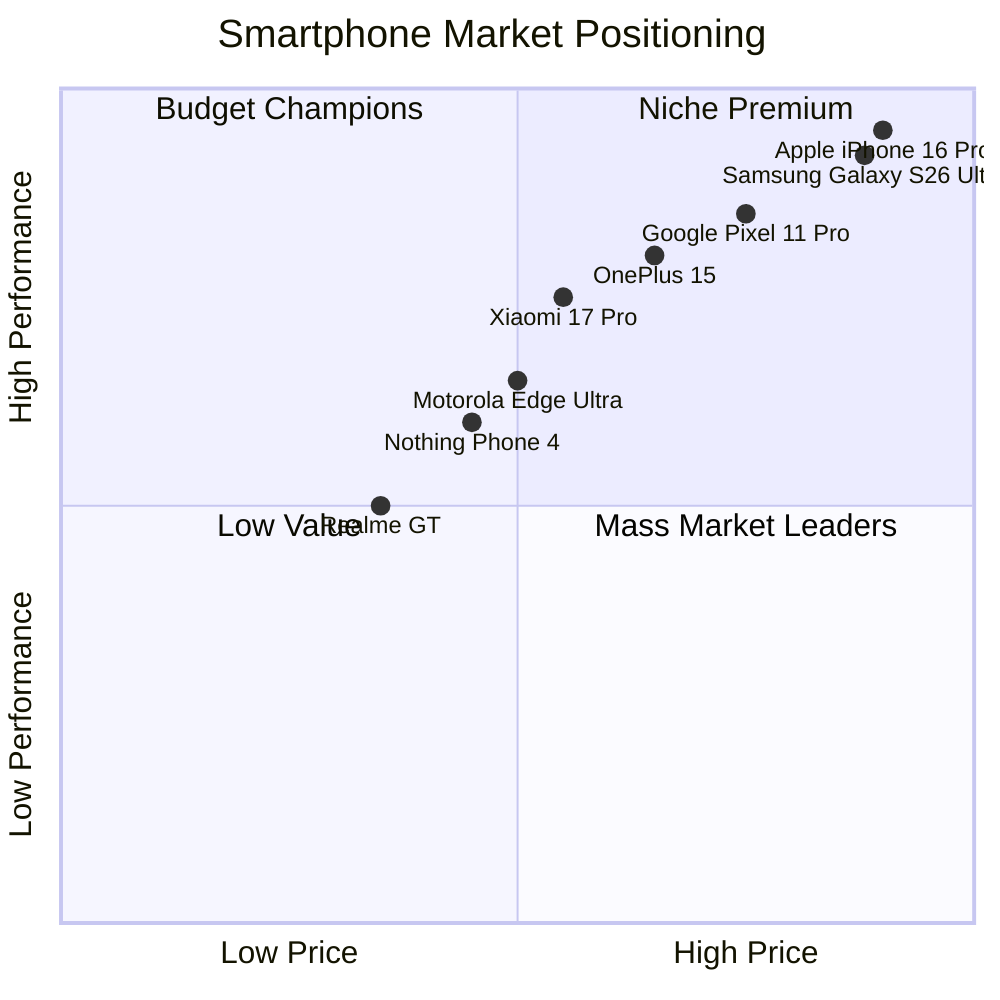

# Quadrant Chart Rules & Standards for Mermaid JS

## Syntax Overview
Mermaid `quadrantChart` renders a 2x2 grid matrix (4 quadrants) with items positioned using normalized x and y coordinates between `0.0` and `1.0`.

## Official Structure & Syntax


## Mandatory Directives & Rules

1. **Header Line**:
   - The first line MUST be `quadrantChart`.

2. **Title**:
   - Syntax: `title Chart Title` or `title "Chart Title"`

3. **Axes**:
   - `x-axis <left label> --> <right label>`
   - `y-axis <bottom label> --> <top label>`
   - **DO NOT** use `x-axis-title` or `y-axis-title` — those are invalid syntax and will break the chart.
   - Use `-->` to separate left/right or bottom/top label extremes.

4. **Quadrants (1 through 4)**:
   - Quadrant numbering is strictly defined as:
     - `quadrant-1`: Top Right (x > 0.5, y > 0.5)
     - `quadrant-2`: Top Left (x < 0.5, y > 0.5)
     - `quadrant-3`: Bottom Left (x < 0.5, y < 0.5)
     - `quadrant-4`: Bottom Right (x > 0.5, y < 0.5)
   - Quadrant label MUST be on the exact same line as the directive:
     - `quadrant-1 Top Right Label`
     - `quadrant-2 Top Left Label`
     - `quadrant-3 Bottom Left Label`
     - `quadrant-4 Bottom Right Label`
   - **DO NOT** place quadrant titles on new lines or create sub-blocks.

5. **Items & Points (Mandatory Coordinates)**:
   - EVERY item MUST be written with numeric coordinates in brackets `[x, y]`:
     - `Item Name: [0.85, 0.90]`
     - `"Item Name": [x, y]`
   - `x` and `y` MUST be numbers between `0.0` and `1.0`.
   - **DO NOT** write item names without coordinates `[x, y]`.
   - **DO NOT** output generic placeholders like `"Item 1"`, `<item1>`, `"Technology 1"`. Always plot the actual items requested in the prompt.

## Anti-Patterns & Common Errors — NEVER DO THESE:

### 1. NEVER Output `quadrantChart` Without Items or Directives
- **WRONG**:
  ```mermaid
  quadrantChart
  ```
- **CORRECT**: Always generate title, axes, quadrant labels, and plotted items.

### 2. NEVER Omit `[x, y]` Coordinates for Items
- **WRONG**:
  ```
  quadrant-1
  "Item 1"
  "Item 2"
  ```
- **CORRECT**:
  ```
  "Item 1": [0.75, 0.8]
  "Item 2": [0.6, 0.9]
  ```

### 3. NEVER Use Invalid Axis Keywords
- **WRONG**:
  ```
  x-axis-title Price
  y-axis-title Performance
  ```
- **CORRECT**:
  ```
  x-axis Low Price --> High Price
  y-axis Low Performance --> High Performance
  ```

### 4. NEVER Use Placeholders or HTML Tags
- **WRONG**:
  ```
  <item1>
  <item2>
  ```
- **CORRECT**:
  ```
  "AI Chatbot": [0.8, 0.7]
  "Mobile App": [0.6, 0.4]
  ```

## Comprehensive Example

