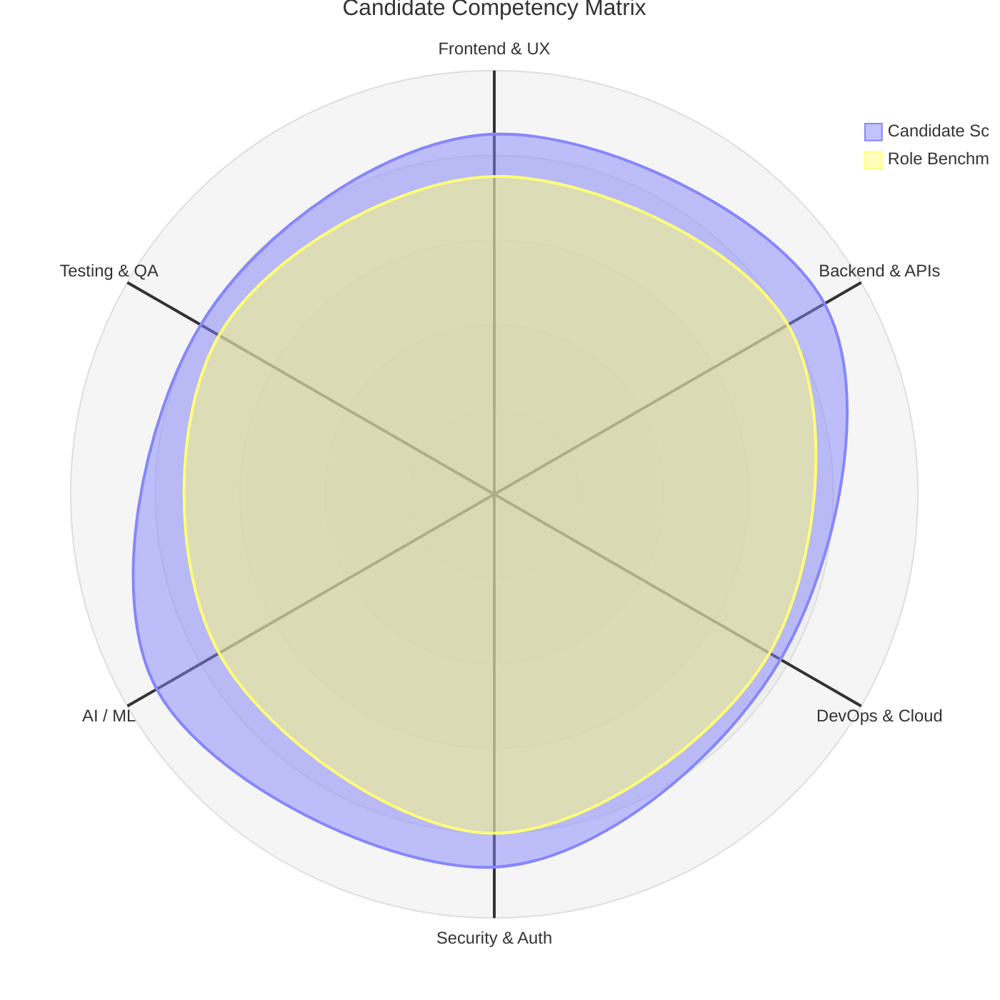
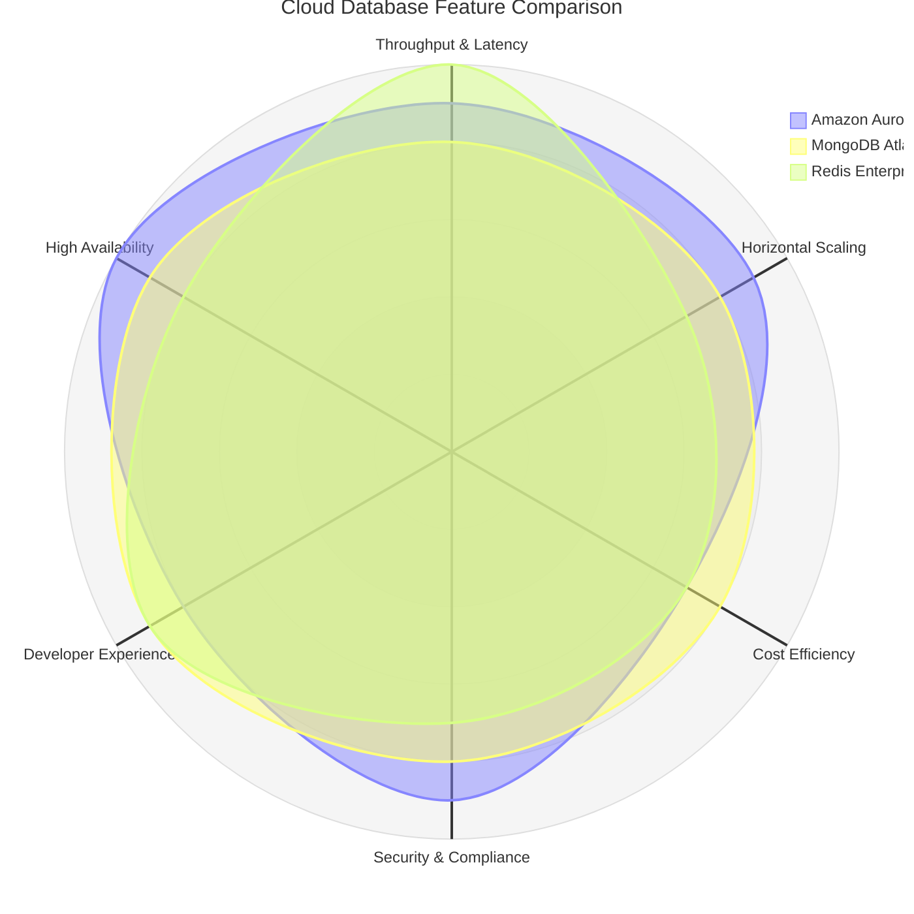
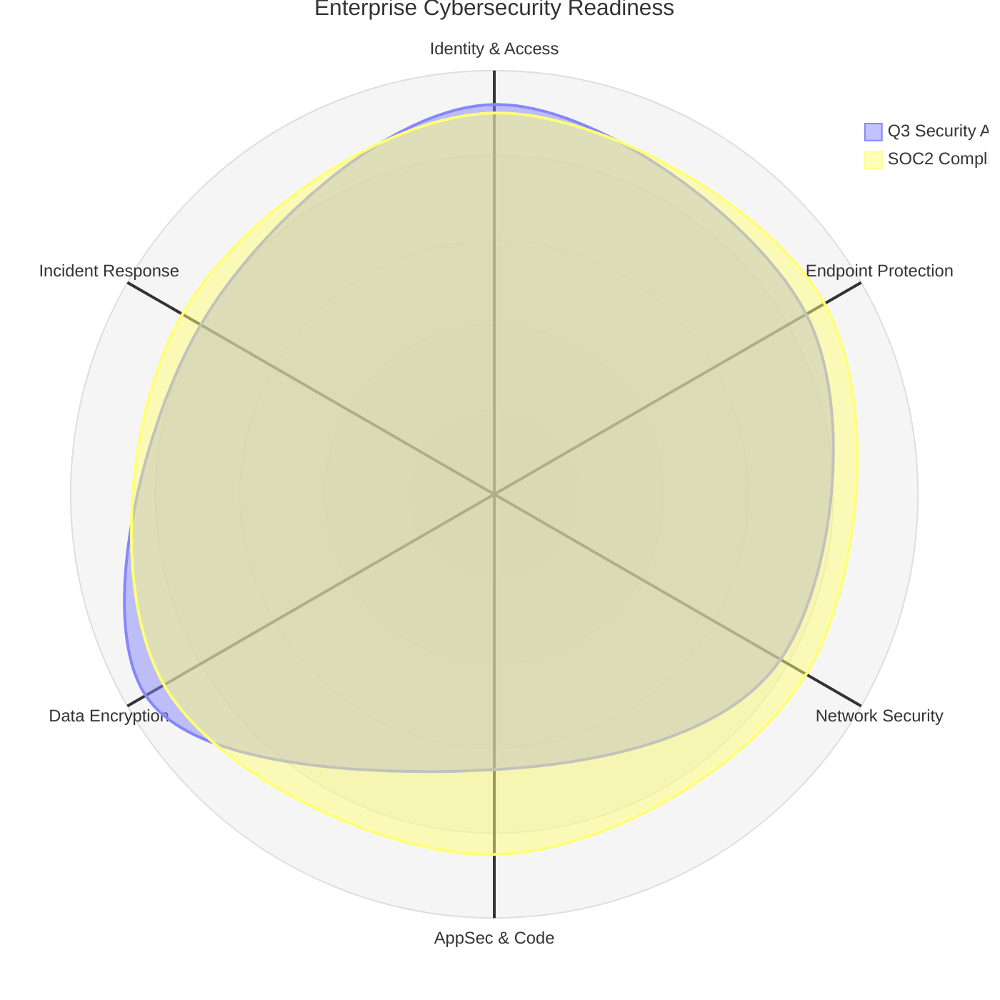

# Radar & Spider Chart Rules & Standards for Mermaid JS

## Overview
Radar charts (also known as spider charts, web charts, or star plots) visualize multi-dimensional quantitative metrics, performance reviews, candidate competency matrices, product feature comparisons, and security posture assessments radiating around a central hub.

## Official Syntax (`radar-beta`)
Mermaid provides dedicated circular radar chart rendering via the `radar-beta` keyword.

### Core Structure

## Syntax Rules
1. **Header**: Always start with `radar-beta` (optionally preceded by standard YAML frontmatter `--- title: "..." ---`).
2. **Axes (`axis`)**:
   - Define spokes using unique IDs and display labels: `axis id1["Label 1"], id2["Label 2"], id3["Label 3"]`
   - You can place all axes on a single line or split across multiple `axis` statements.
   - Standard radar charts are clearest with **5 to 8 dimensions**.
3. **Data Series (`curve`)**:
   - Define data curves with an ID, legend label in brackets, and array of numeric values inside curly braces:
     `curve p1["Senior Engineer"]{85, 90, 80, 75, 92, 88}`
   - The number of values in curly braces **MUST exactly match** the total number of declared axes.
   - You can plot multiple curves (e.g. comparing candidate vs benchmark, product A vs product B).
4. **Scale Limits (`min` / `max`)**:
   - Declare the maximum scale value using `max <number>` (e.g. `max 100` or `max 10`).
   - Declare the minimum scale value using `min <number>` (e.g. `min 0`).

## Realistic Examples

### Example 1: Product Feature Comparison (Scale 1 - 10)

### Example 2: Cybersecurity Threat & Posture Assessment (Scale 0 - 100)

## Anti-Patterns & Critical Pitfalls to Avoid
- ❌ **NEVER** use `xychart-beta` for radar charts. `xychart-beta` is for rectangular Cartesian line/bar charts, not circular spider charts.
- ❌ **NEVER** declare curves with mismatched value counts. If there are 6 axes, every curve must have exactly 6 values.
- ❌ **NEVER** use parentheses `(...)` for curve values. Values must be in curly braces `{85, 90, ...}`.
