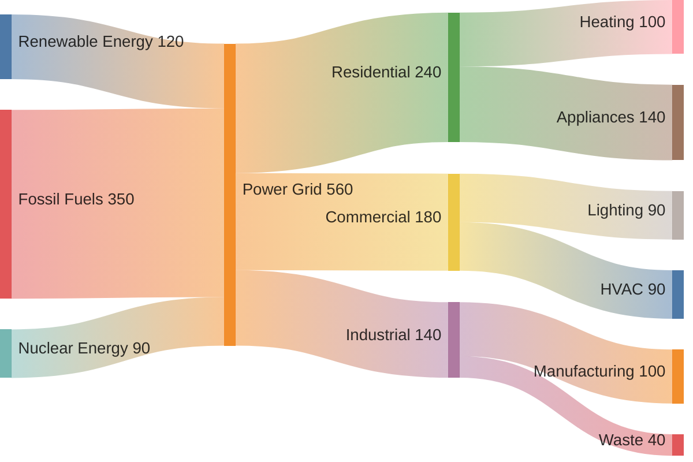
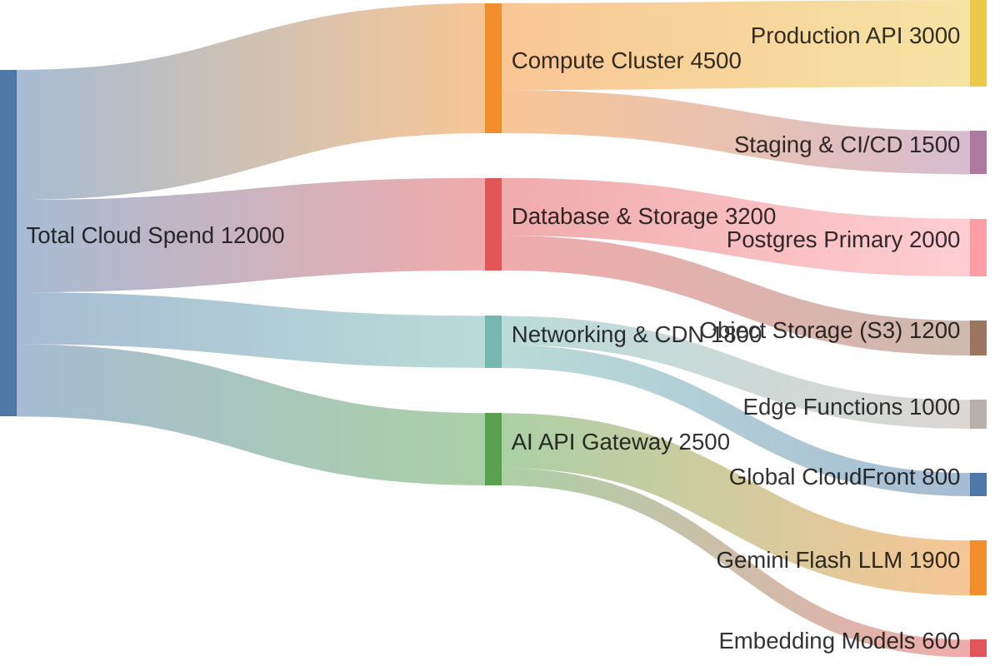

# Sankey Diagram Rules & Standards for Mermaid JS (`sankey-beta`)

## Overview
The `sankey-beta` diagram type in Mermaid JS visualizes flow volumes, material transfers, energy transfers, budget breakdowns, and multi-tier conversion funnels where line thickness is proportional to the quantity transferred.

---

## Syntax & Core Directives

### 1. Header Declaration
The diagram definition begins with:
```mermaid
sankey-beta
```
*(Optional theme configuration frontmatter can be prefixed if desired)*:
```mermaid
---
config:
  theme: default
---
sankey-beta
```

### 2. CSV Flow Data Rows
Each flow row represents a transfer from a Source to a Target with a numeric value:
`Source, Target, Value`



---

## Best Practices
1. **UNQUOTED NODE NAMES**: Always write node names as plain unquoted text (`Renewable Energy, Power Grid, 120`).
2. **POSITIVE NUMERIC VALUES ONLY**: Values must be positive integers or floating-point numbers without commas, percentage signs (`%`), or currency symbols (`$`).
3. **CONSERVE FLOW BALANCE**: Multi-tier flows should balance logically (the incoming sum to a node should roughly equal its outgoing sum).
4. **AVOID CYCLES & LOOPS**: Sankey diagrams are strictly Directed Acyclic Graphs (DAGs). Node A cannot flow to Node B if Node B flows back to Node A.

---

## CRITICAL Anti-Patterns — NEVER DO THESE

### 1. NEVER Wrap Node Names in Double Quotes
Mermaid's `sankey-beta` parser expects unquoted comma-separated tokens. Surrounding double quotes cause syntax crashes (`Expecting 'NEWLINE', 'EOF', 'COMMA', got 'DQUOTE'`).
- **WRONG**:
  ```
  sankey-beta
  "Renewable Energy", "Power Grid", 120
  "Fossil Fuels", "Power Grid", 350
  ```
- **CORRECT**:
  ```
  sankey-beta
  Renewable Energy, Power Grid, 120
  Fossil Fuels, Power Grid, 350
  ```

### 2. NEVER Use Flowchart Connectors (`-->`, `->`, `==>`)
Sankey diagrams use CSV comma separation only.
- **WRONG**:
  ```
  Revenue --> Operating Costs: 60
  ```
- **CORRECT**:
  ```
  Revenue, Operating Costs, 60
  ```

### 3. NEVER Include Titles or Legends Inside the Diagram Body
Mermaid `sankey-beta` does not support `title` or `legend` keywords inside the body. Use frontmatter if needed.

---

## Complete Examples

### Example 1: Energy Grid Flow Allocation


### Example 2: SaaS Cloud Infrastructure Spend

