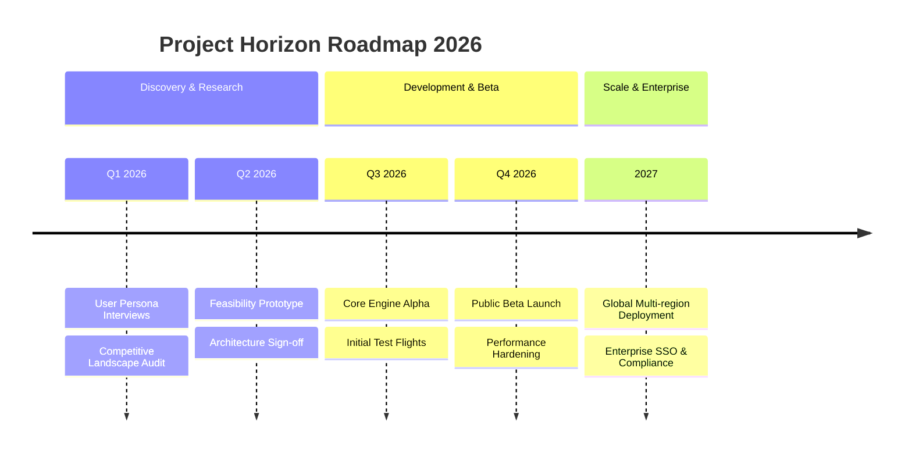
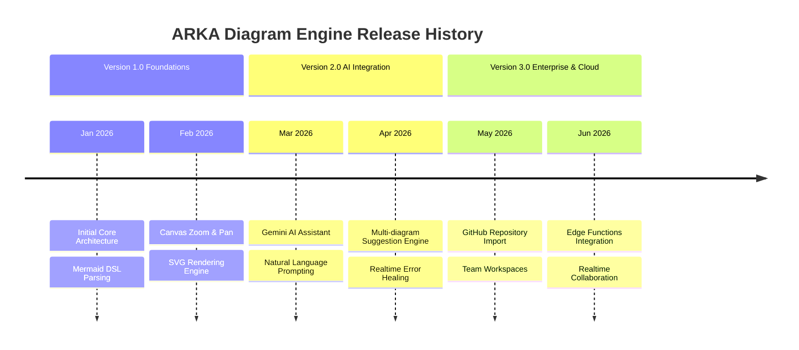
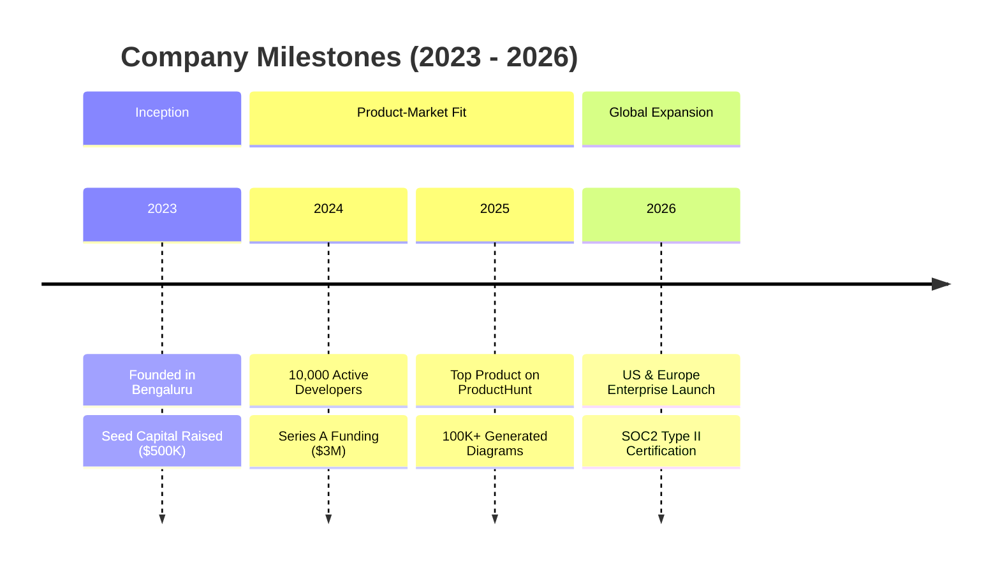

# Timeline Diagram Rules & Standards for Mermaid JS

## Overview
The `timeline` diagram type in Mermaid JS is designed to visualize chronological milestones, project roadmaps, historical events, and phased releases along an intuitive horizontal or grouped axis.

## Syntax & Core Directives
- **Directive**: Always begin with `timeline`.
- **Title**: Use `title "..."` to declare the timeline name.
- **Sections**: Group chronological events into eras or phases using `section Phase Name`.
- **Time Periods & Events**:
  - `Period : Event Description`
  - Multiple events under the same period: `Period : Event 1 : Event 2 : Event 3`
  - Wrapped descriptions on subsequent indented lines:
    ```
    Period : Event One
           : Event Two
    ```

## Standard Structure


## Best Practices
1. **CHRONOLOGICAL ORDERING**: Always list sections and time periods in strict chronological order (past to future or step 1 to step N).
2. **CONCISE EVENT TEXT**: Keep individual event labels crisp and informative (under 60 characters each).
3. **SECTION ORGANIZATION**: Divide the timeline into 3 to 6 logical sections (e.g. Quarters, Phases, Versions, Decades) to prevent overcrowding.
4. **CONSISTENT PERIOD LABELS**: Use a consistent date/time format across the timeline (e.g., all `YYYY`, all `Q1 YYYY`, or all `Sprint N`).
5. **MULTIPLE EVENTS PER MILESTONE**: Group concurrent events under a single time period using colons (`:`) rather than repeating the same period key.

## CRITICAL Anti-Patterns — NEVER DO THESE

### 1. NEVER Use HTML Tags or Line Breaks Inside Events
Do not insert `<br/>`, `<b>`, `<span>`, or other HTML elements inside timeline event text.
- **WRONG**:
  ```
  2026 : <b>Alpha Release</b><br/>Core features
  ```
- **CORRECT**:
  ```
  2026 : Alpha Release : Core features implemented
  ```

### 2. NEVER Use Arrow Connectors (`-->`, `->>`)
Timeline diagrams do not use node connection arrows. The progression is inferred from the chronological flow.
- **WRONG**:
  ```
  2024 --> 2025 --> 2026
  ```
- **CORRECT**:
  ```
  2024 : Launch Phase 1
  2025 : Expand Infrastructure
  2026 : Enterprise Scale
  ```

### 3. NEVER Use Colon as Part of Event Text Without Escaping
Colons (`:`) act as event delimiters. If your event title contains a colon, rephrase it or omit the literal colon.
- **WRONG**:
  ```
  2026 : Feature: Dark Mode
  ```
- **CORRECT**:
  ```
  2026 : Feature - Dark Mode
  ```

## Examples

### Example 1: Software Product Evolution


### Example 2: Startup Growth Journey

