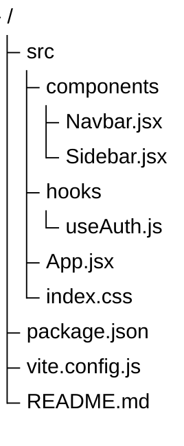
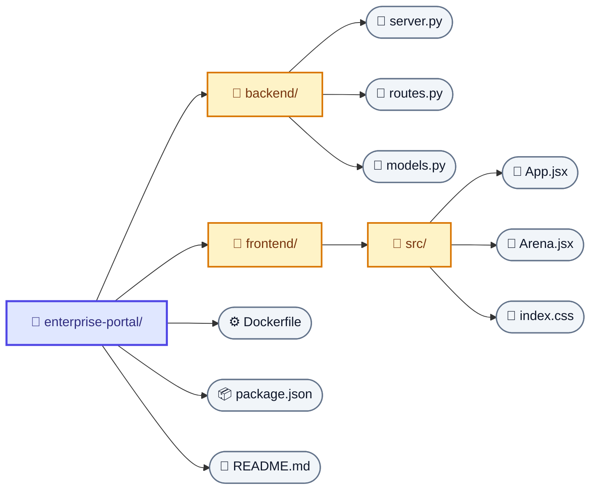

# TreeView Diagram Rules & Standards for Arka

## Overview
The TreeView diagram visualizes deep folder hierarchies, file systems, abstract syntax trees (AST), taxonomy classifications, organizational breakdowns, and hierarchical navigation structures.

Arka supports two official formats for TreeView diagrams:
1. **Native Directory Tree (`treeView-beta`)** — **[DEFAULT]** Indented, human-readable file-tree format rendered as a clean directory hierarchy with branch connector lines (`- /`, `├─`, `└─`).
2. **Flowchart Graph (`flowchart LR`)** — Visual node-graph format with Left-to-Right orientation (`flowchart LR`), distinct folder/file shapes, semantic emojis, and warm color tokens.

---

## Pattern A: Native Directory Tree (`treeView-beta`) [DEFAULT]

### Syntax & Core Directives
1. **Header Line**: Line 1 MUST be exactly `treeView-beta`.
2. **Indentation**: Indent child folders and files with 2 spaces per depth level.
3. **Double Quotes**: Enclose all directory and file names in double quotes (`"src"`, `"App.jsx"`).
4. **Clean Hierarchy**: Do NOT use node brackets (`[...]`), `-->`, or `classDef`. Use pure hierarchical indented text.

### Example:

---

## Pattern B: Flowchart Hierarchy (`flowchart LR`)

### Syntax & Core Directives
1. **Orientation**: Direction MUST be `flowchart LR` (Left-to-Right orientation).
2. **Shape Distinction**:
   - **Root Project Node**: Rectangle `Root["📁 project-name"]:::rootNode`
   - **Folders / Directories**: Rectangle `Dir["📁 folder-name"]:::folder`
   - **Files / Documents**: Stadium shape `File(["📄 file.ext"]):::file`

3. **Emoji Semantics**:
   - `📁` for directories / folders
   - `📄` for code and scripts (`.jsx`, `.js`, `.py`, `.ts`, `.go`)
   - `📦` for dependency and lockfiles (`package.json`, `pnpm-lock.yaml`)
   - `⚙️` for environment and build configs (`.env`, `vite.config.js`, `tsconfig.json`)
   - `🖼️` for static media and images (`logo.svg`, `banner.png`, `favicon.ico`)
   - `📝` for documentation and markdown (`README.md`, `CHANGELOG.md`, `LICENSE`)

4. **Color Tokens**:
   - **Folders**: Warm Amber background (`#fef3c7`) with rich amber outline (`#d97706`) and dark text (`#78350f`).
   - **Files**: Clean Slate background (`#f1f5f9`) with slate outline (`#64748b`) and dark text (`#0f172a`).
   - **Root**: Indigo / Primary background (`#e0e7ff`) with primary border (`#4f46e5`) and deep indigo text (`#312e81`).

5. **Hierarchical Flow**:
   - Edges connect strictly from parent to child: `Parent --> Child` (flowing left to right).
   - Never create reverse or circular links.

### Example:

