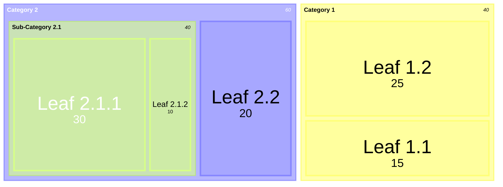
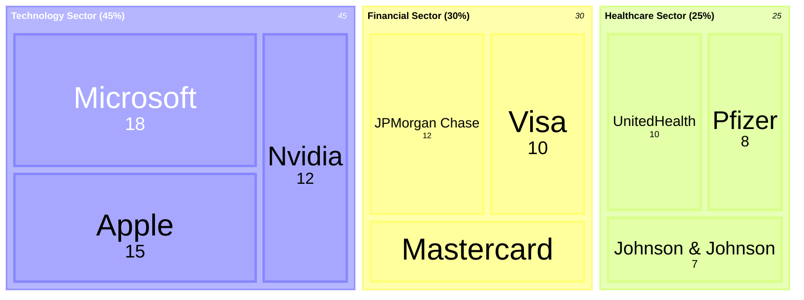
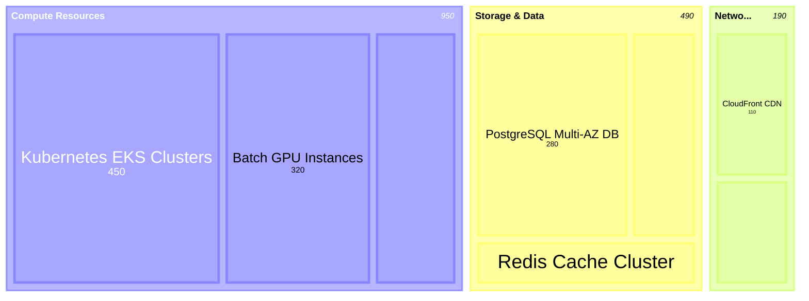

# Treemap Diagram Rules & Standards for Mermaid JS

## Overview
Mermaid JS natively supports official Treemap charts using the `treemap-beta` diagram type. Treemaps display hierarchical data as a set of nested, proportionally sized rectangles tiled according to their numeric values.

## Syntax & Core Structure

---

## Mandatory Directives & Rules

1. **Header Line**:
   - Line 1 MUST be exactly `treemap-beta`.
   - **NEVER** use `flowchart TD`, `graph`, `subgraph`, or `mindmap`.

2. **Categories & Sections**:
   - Declare category and section names enclosed in double quotes (e.g. `"Technology"`, `"Financial Sector"`).

3. **Leaf Nodes & Values**:
   - Declare child leaf items indented under their respective category.
   - Leaf items MUST specify a numeric value after a colon: `"Item Label": <number>` (e.g. `"Apple": 15`, `"Microservices": 45`).

4. **Multi-level Hierarchy**:
   - Support nested sub-categories by adding an extra indentation level before declaring leaves with numeric values.

5. **No Flowchart Syntax**:
   - **NEVER** use node brackets (`[...]`), `-->`, `classDef`, `style`, or `subgraph`.
   - Treemaps rely purely on indented strings with `: <number>` leaf weights.

---

## Realistic Examples

### Example 1: Investment Portfolio Allocation

### Example 2: Cloud Infrastructure Cost Breakdown

