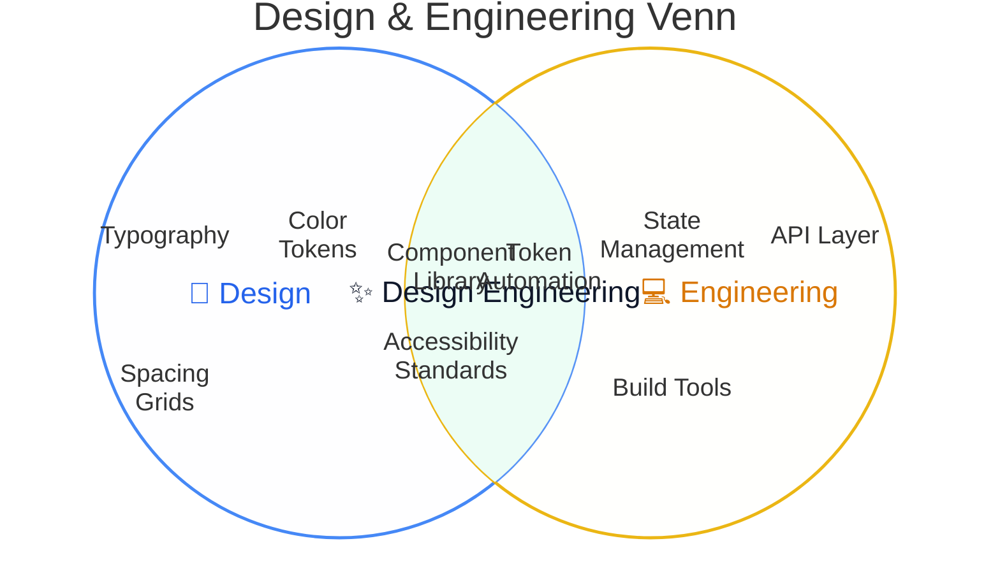
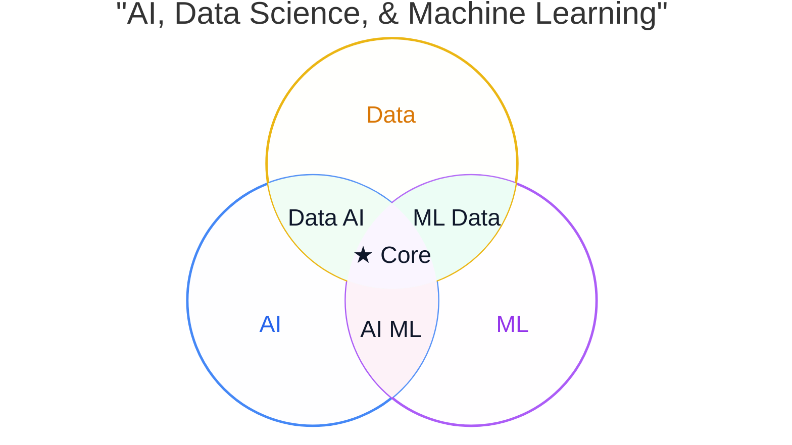

# Venn Diagram Rules & Standards for Mermaid JS (`venn-beta`)

## Overview
Mermaid JS supports native geometric Venn diagrams via the `venn-beta` directive. It computes true overlapping circle/ellipse geometry, shaded intersection regions, and localized text annotations.

---

## Syntax & Core Directives

### 1. Header Declaration
The diagram definition MUST begin with:
```mermaid
venn-beta
```
*(Optional Elk layout configuration frontmatter can be prefixed if desired)*:
```mermaid
---
config:
  layout: elk
---
venn-beta
```

### 2. Title
```mermaid
title Product-Market Fit & Domain Intersections
```

### 3. Declaring Sets
Sets are declared with the `set` keyword:
- `set SetName`
- `set SetName ["Descriptive Label"]`
- `set SetName ["Label"]: size_number`
- `set SetName: size_number`

```mermaid
set A ["Design System"]
set B ["Frontend Engineering"]
set C ["Product Strategy"]
```

### 4. Declaring Unions & Intersections
Shared overlapping regions between 2 or more sets are declared with the `union` keyword followed by comma-separated set identifiers:
- `union SetA, SetB`
- `union SetA, SetB ["Intersection Label"]`
- `union SetA, SetB ["Label"]: size_number`
- `union SetA, SetB, SetC ["Core Intersection"]: size_number`

```mermaid
union A, B ["Design Engineering"]
union B, C ["Tech Feasibility"]
union A, C ["UX Research"]
union A, B, C ["★ Sweet Spot (PMF)"]
```

### 5. Adding Text Items (Bullet Points & Features)
Text entries can be indented under sets or unions:
```mermaid
set A ["Design"]
  text "Typography"
  text "Color Tokens"
  text "Motion Design"

set B ["Engineering"]
  text "State Management"
  text "REST / GraphQL"

union A, B ["Design Systems"]
  text "Component Library"
  text "Token Sync"
```

### 6. Styling Sets and Overlaps
Customize colors using the `style` directive with hex colors. Set label text `color` should match the set `stroke` for vibrant, immediate visual recognition, while intersection text uses dark high-contrast color (`color:#0f172a`):
```mermaid
style A fill:#eff6ff,stroke:#3b82f6,color:#2563eb
style B fill:#faf5ff,stroke:#a855f7,color:#9333ea
style C fill:#fefce8,stroke:#eab308,color:#d97706
style A, B fill:#ecfdf5,stroke:#10b981,color:#0f172a
style A, B, C fill:#fdf2f8,stroke:#ec4899,color:#0f172a
```

---

## Complete Examples

### Example 1: 2-Set Venn Diagram (Design vs Engineering)


### Example 2: 3-Set Venn Diagram (AI, ML & Data Science)


---

## Anti-Patterns — NEVER DO THESE
1. **NEVER use flowchart `subgraph` for Venn diagrams**: Venn diagrams in Mermaid must use `venn-beta`.
2. **NEVER connect sets with arrows (`-->`, `---`) in `venn-beta`**: Intersection geometry is automatically computed using `union SetA, SetB`.
