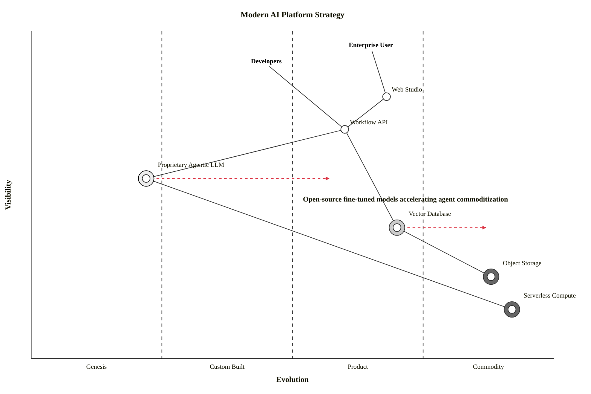

# Wardley Map Rules & Standards for Mermaid JS (wardley-beta)

## Overview
A Wardley Map is a strategic framework created by Simon Wardley to map business value chains and the evolutionary lifecycle of components.

In Mermaid (v11.14.0+), Wardley Maps are natively supported via the `wardley-beta` diagram type.

---

## 1. Core Dimensions & Coordinate System
Every component is positioned on a 2D canvas using the OnlineWardleyMaps (OWM) standard format:
`[visibility, evolution]`

> **CRITICAL**: The coordinate order is `[visibility, evolution]` (Y, X), NOT (X, Y)!
- **Visibility (Y-Axis)**: `0.0` to `1.0` (bottom to top).
  - `1.0` = Highly visible (direct user/customer need at the top).
  - `0.0` = Invisible underlying infrastructure (at the bottom).
- **Evolution (X-Axis)**: `0.0` to `1.0` (left to right across 4 evolutionary stages):
  1. **Genesis** (`0.00` - `0.25`): Novel, bespoke research, high uncertainty, exploration.
  2. **Custom-Built** (`0.25` - `0.50`): Handcrafted, proprietary implementations, early adoption.
  3. **Product / Rental** (`0.50` - `0.75`): Standardized off-the-shelf software packages, products, SaaS.
  4. **Commodity / Utility** (`0.75` - `1.00`): Standardized utility services, cloud primitives, electricity.

---

## 2. Mermaid Syntax & Directives

### A. Diagram Header
```mermaid
wardley-beta
title Value Chain Strategy Map
```
Optional canvas sizing:
```
size [1100, 600]
```

### B. Anchors (Users & Customers)
Anchors represent user groups or external stakeholders at high visibility:
```
anchor Business [0.95, 0.63]
anchor Customer [0.90, 0.50]
```

### C. Components
Standard components on the map:
```
component Web Application [0.75, 0.65]
component API Gateway [0.60, 0.72]
component Custom ML Engine [0.45, 0.20]
component Database [0.30, 0.80]
```

### D. Decorators & Source Strategy
Decorators visually mark strategy decisions or organizational friction:
- `(build)` - Triangle symbol (In-house proprietary build)
- `(buy)` - Diamond symbol (Commercial off-the-shelf purchase)
- `(outsource)` - Square symbol (Third-party managed outsourcing)
- `(market)` - Circle symbol (Marketplace supplier)
- `(inertia)` - Barrier / block symbol indicating resistance to change

Examples:
```
component AI Algorithm [0.50, 0.18] (build)
component CRM System [0.65, 0.68] (buy)
component Server Hosting [0.15, 0.85] (outsource)
component Legacy Monolith [0.40, 0.35] (inertia)
```

### E. Links & Dependencies
Connect components along the value chain from consumer to provider:
```
Customer -> Web Application
Web Application -> API Gateway
API Gateway -> Custom ML Engine
API Gateway -> Database
Database -> Cloud Infrastructure
```
Alternative link types:
- `A -> B` : Basic dependency
- `A --> B` : Basic dependency (alternative)
- `A -> B; "data flow"` : Annotated link
- `A -.- > B` : Dashed dependency
- `A +> B` : Flow with directional marker

### F. Evolution Movement
Show components actively migrating rightward along the evolution axis:
```
evolve Custom ML Engine 0.55
evolve Database 0.90
```

### G. Notes & Annotations
Contextual insights positioned on the map:
```
note "Migrating database to managed commodity cloud" [0.28, 0.78]
note "Custom AI engine moving towards productized microservice" [0.42, 0.50]
```

---

## 3. Complete Canonical Examples

### Example 1: Classic Tea Shop Value Chain
```mermaid
wardley-beta
title Tea Shop Value Chain

anchor Business [0.95, 0.63]
anchor Public [0.95, 0.40]

component Cup of Tea [0.79, 0.61]
component Tea [0.63, 0.81]
component Hot Water [0.52, 0.80]
component Kettle [0.43, 0.35] (build)
component Power [0.10, 0.70] (buy)

Business -> Cup of Tea
Public -> Cup of Tea
Cup of Tea -> Tea
Cup of Tea -> Hot Water
Hot Water -> Kettle
Hot Water -> Tea
Kettle -> Power

evolve Kettle 0.62
evolve Power 0.89

note "Standardising power allows Kettles to evolve faster" [0.37, 0.58]
```

### Example 2: Modern AI SaaS Value Chain


---

## 4. CRITICAL Anti-Patterns — NEVER DO THESE
1. **NEVER use `flowchart LR` or `flowchart TD` or `quadrantChart` for Wardley Maps**. Always start with `wardley-beta`.
2. **NEVER invert the coordinate order**: First coordinate MUST be visibility `[0.0 - 1.0]` (Y-axis), second coordinate MUST be evolution `[0.0 - 1.0]` (X-axis).
3. **NEVER use flowchart node shapes** like `["..."]` or `(["..."])` inside `wardley-beta`. Use `component Name [vis, evo]` or `anchor Name [vis, evo]`.
4. **ALWAYS connect dependencies** with `A -> B` matching the exact declared component/anchor names.
